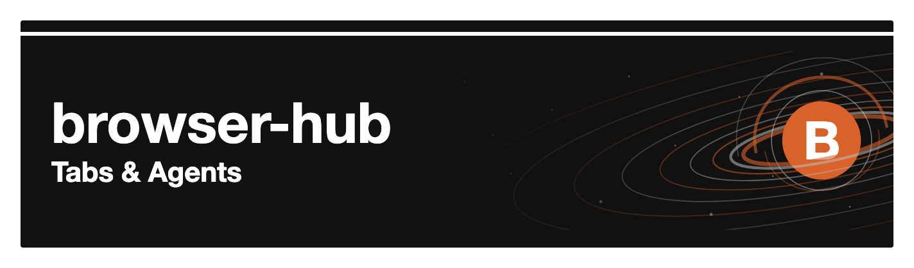

<p align="center"></p>

# browser-hub

[](LICENSE)

browser-hub gives every Claude Code session and subagent on your Mac a real Chrome you've signed
into, one per profile. Any number of agents share it at once through playwright-mcp, each in its
own tabs, and their tabs open in windows behind yours instead of fighting you for keyboard focus.
Chrome starts on the first browser call and quits when it has been idle for a while.

## What it does

- **Your logins, not a blank browser.** The main session's `mcp__playwright__*` tools drive a
  persistent, headed Chrome that you've signed into once, 1Password extension and all.
- **Many agents, one browser.** Any number of sessions and subagents can use the same Chrome at
  once. Each works in its own tabs, and the included agent rules keep them out of each other's way.
- **Separate identities.** Add a profile per identity (work, a client, a store account). Each
  profile is its own Chrome, and only its own `browser-<profile>` subagent is given its tools.
  That separation is tool routing, not access control (see [Trust model](#trust-model)).
- **Parallel agents on one profile.** "Lanes" give several subagents safe, concurrent access to
  the same profile.
- **No idle cost.** Chrome starts on first use (~2-10 s) and quits after two hours idle. Only a
  ~30 MB MCP server stays running.
- **It stays out of your way.** Agents' tabs open in windows behind yours, so you can keep typing
  while they browse. This is best effort, with known exceptions (`docs/DESIGN.md` §11): a tab
  hidden behind another in its window is brought forward so it can render, a page's own popup
  (OAuth, payments) opens in front, a cold start can hold focus for a fraction of a second, and if
  the guard can't load its WebSocket library the hub runs unguarded.
- **It repairs itself.** If Chrome is closed or crashes, the next browser call brings it back.
- **Scripted lookups.** `hubctl run` reads known pages with a small script instead of a model.

macOS only (it runs on launchd). Version 1.1.0. It drives browsers you are signed into, with no
authentication on its local ports: read [Trust model](#trust-model) before installing.

## Quick start

Needs macOS, Google Chrome, Node 18+ and Claude Code (details under [Requirements](#requirements)).

```sh
git clone https://github.com/milesshebar/browser-hub.git ~/browser-hub
cd ~/browser-hub
./install.sh                                        # launchd jobs, MCP server, hooks, agent rules
./hubctl open default https://accounts.google.com   # sign the default profile in, once
./hubctl add work --identity "work Google account, Jira"   # optional: a second identity
./hubctl open work https://accounts.google.com
```

Start a new Claude Code session. The main session now browses with `mcp__playwright__*` (the
`default` profile), and `hubctl add` wrote a `browser-work` agent for the `work` profile, so
"use browser-work to …" sends a task there. To point an agent you already have at a profile, see
`AGENTS.md`, "Common adaptations". The sections below cover each step in full.

## Why this exists

The obvious setups all break once more than one agent needs a browser:

- **Stock playwright MCP** launches its own browser per session. It has none of your logins, and a
  second session pointed at the same profile hits Chrome's profile lock.
- **Claude in Chrome** drives your personal browser and supports one session at a time.
- **Several sessions on one playwright-mcp server** without `--shared-browser-context` evict each
  other. With it, they share one current tab and navigate each other's pages unless every agent
  follows tab discipline.

browser-hub runs Chrome under launchd on a dedicated profile, puts one playwright-mcp hub in front
of each Chrome (in the mode built for many clients), starts and stops it all on demand, and gives
agents the rules that make sharing safe. `docs/DESIGN.md` explains each decision and the evidence
behind it.

## Requirements

- macOS, with Google Chrome in `/Applications`
- Node 18+ with `npx`. Homebrew's node is the best choice (`brew install node`), because an nvm
  path breaks when that node version is removed.
- `python3` (the Xcode command line tools provide one)
- Claude Code
- Optional, only for the manual cookie-recovery script in `tools/`: Python's `cryptography`
  package (`python3 -m pip install --user cryptography`)

## Install

```sh
git clone https://github.com/milesshebar/browser-hub.git ~/browser-hub   # jobs run from here: see below
cd ~/browser-hub
./install.sh --dry-run                   # optional: see what it will touch
./install.sh
```

Keep the repo somewhere permanent, with no spaces in its path, and outside Documents, Desktop,
Downloads and iCloud Drive: macOS privacy protection can block launchd jobs from reading those.
If you move it later, re-run `./install.sh` from the new place. Upgrading an existing install:
`git pull`, then follow the upgrade note in `CHANGELOG.md`.

`install.sh` is safe to re-run. It:

1. writes `~/.config/browser-hub/config` from what it detects (edit it later; see `config.example`)
2. creates the launchd jobs for the `default` profile plus an idle reaper, and starts the hub
3. registers the hub as the user-scope MCP server `playwright`. If you already have a *different*
   server named `playwright`, it stops there, before touching anything in `~/.claude`. Re-run
   with `--force-mcp` to replace it.
4. adds two `PreToolUse` hooks to `~/.claude/settings.json`, backing the file up first
5. writes a `browser-default` agent unless an agent already targets the default hub
6. adds a marked block of browser rules to `~/.claude/CLAUDE.md` (backed up first). Re-running
   updates the block, and `--no-claude-md` skips it.
7. runs `hubctl doctor`

Then:

1. **Restart your Claude Code sessions.** Hooks and MCP servers load at session start.
2. **Put `hubctl` on your PATH** (the rest of this README assumes it is):
   `ln -s ~/browser-hub/hubctl /opt/homebrew/bin/hubctl`
3. **Sign the default profile in.** It's a normal Chrome window, so install extensions there too:
   `hubctl open default https://accounts.google.com`
4. **Say what it's signed into.** The orchestrator routes work to agents by their description:
   `hubctl agent default --identity "personal Google account, GitHub, the bank" --force`

Setting this up with an AI agent? Point it at `AGENTS.md`.

### Trying it without touching an existing setup

Every path, port and launchd label comes from the config file, and `BROWSER_HUB_CONFIG` picks
which config file to use. A second, throwaway instance is a config in a temp dir. Set these keys:
`LABEL_PREFIX`, `DEFAULT_CDP_PORT`, `DEFAULT_HUB_PORT`, `PROFILES_DIR`, `STATE_DIR`,
`LAUNCH_AGENTS_DIR`, `AGENTS_DIR`, `CLAUDE_MD` and `CLAUDE_SETTINGS`, all pointing inside the temp
dir. Then run everything with that config exported:

```sh
export BROWSER_HUB_CONFIG=/tmp/bh-try/config
./install.sh --no-mcp          # the MCP registration is user-global, so skip it in a sandbox
./uninstall.sh --no-mcp --remove-agents
```

`CLAUDE_BIN` points the scripts at a different `claude` executable, such as a stub. The live tests
(`tests/test_live.py`) build exactly this kind of sandbox and are a working example.

## Using it

**Browse from the main session.** Just ask. The session's `mcp__playwright__*` tools are the
`default` profile, and the hook starts Chrome before the first call.

**Delegate browsing** to the `browser-default` agent. This keeps big page snapshots out of your
main conversation.

**Add a profile** for a separate identity:

```sh
hubctl add work --identity "work Google account, Jira, the AWS console"
hubctl open work https://accounts.google.com     # sign in, in the window that opens
```

Start a new Claude Code session, and `browser-work` is available. The main session isn't given the
`work` profile's tools; only its agent is. That keeps the main conversation's tool list short and
sends work to the right identity on purpose. It is a convention, not a lock: anything that can run
commands on the Mac, a session with a shell included, can reach every profile's local ports.

**Run agents in parallel on one profile** with lanes:

```sh
hubctl lanes work 3        # browser-work, browser-work-2, browser-work-3
```

Give each concurrent agent a different lane. Two agents with the *same* name share one MCP
connection and one current-tab pointer, and they will fight. Agents on different profiles are
always safe to run in parallel.

**Look things up without a model.** `hubctl run <profile> <extractor> <id…>` runs a small
script from `extractors/` against a profile's logged-in Chrome, in a tab of its own, and prints
JSON:

```sh
hubctl run work amazon B0D6NN6TM7 B0CBRJ63RT      # price, seller, ships-from, stock, condition
hubctl run work bhphoto 1975130-REG 'q:RTX 5090'  # a product, or the top search results
hubctl run work newegg N82E16819113844            # the "Buy New" price; used is reported apart
hubctl run work microcenter 705936@029            # a product, at one store (029: ship-only)
```

The included extractors cover Amazon, B&H, Newegg and Micro Center. Selectors rot as sites
change; `hubctl run <profile> --check` runs each extractor against its own known-good ids.
It exits 0 when every item came back complete, 3 when some field was empty or the item wasn't
found (fall back to a browser agent for those), and 4 when the site put up a login or captcha
wall. A lookup takes 0.5-3 s and no model tokens; the same lookup by a browser agent took 12-60 s.
An extractor is an ES module exporting `name`, `url(id)` and `async lookup(page, id)`, where
`page` is a Playwright page, so a snippet that works in `browser_run_code_unsafe` ports straight
over. Pass a path instead of a name to try one out before adding it. Outside `extractors/`, name
the file `.mjs`: without that folder's `package.json`, older Node versions (18 among them) read a
`.js` file as CommonJS and fail on its `import`.

**Drive a profile from your own scripts.** Run `hubctl up <profile>`, then connect to its CDP port
(`hubctl list` shows it). Open your own tab, use it and close it. Never adopt an existing tab by
URL, because in a shared browser that tab belongs to someone else.

### Profiles on another Mac

Sessions on one Mac can drive a profile whose Chrome runs on another Mac, such as a laptop, as
easily as a local one. Both Macs run browser-hub. The other Mac's profile becomes a **remote
profile** here, reached over ssh:

```sh
# on the laptop: browser-hub installed, with its own port range (see below)
# on this Mac:
hubctl add laptop-work --remote laptop:work     # <ssh host>:<its profile name there>
hubctl push laptop-work --stop                  # copy this Mac's "work" profile there: logins and all
```

`browser-laptop-work` is then an agent like any other. Its MCP server is an ssh tunnel to the
laptop's hub, and the hook starts the tunnel and the laptop's Chrome on first use. `hubctl up`,
`down`, `open` (the window opens on the laptop's screen), `run` and `lanes` all work on it from
here. The agent is a copy of this Mac's agent for the same profile, with a description that keeps
ordinary work on this Mac: it is used only when a task asks for the laptop.

- **ssh.** `<ssh host>` is anything `ssh` reaches without a prompt (an alias in `~/.ssh/config`,
  with a key that needs no passphrase or one held by the agent). The other Mac's `hubctl` is
  assumed to be at the same path as this one's. If it isn't, pass `--hubctl "<path>"`.
- **Ports.** A tunnel keeps the hub's port number, because playwright-mcp only answers requests
  addressed to its own port. So give each Mac its own range: e.g. `DEFAULT_CDP_PORT=9323` and
  `DEFAULT_HUB_PORT=9031` in the laptop's config. `add --remote` refuses a port this Mac already
  uses.
- **Keeping the copies identical.** `hubctl push <remote-profile>` makes the other Mac's copy the
  same as this one's; `hubctl pull` goes the other way. Each run is one direction, never a merge.
  Both Chromes have to be stopped (`--stop` does it, closing their tabs), and both stay held down
  for the copy. Caches, lock files and Chrome's on-device AI model are left out, so ~1 GB copies as
  ~100 MB. The copy being replaced is kept beside it as `<profile dir>.before-copy-<time>` (an APFS
  clone, so it costs no space until the two drift apart); the newest two are kept.
- **Files the browser writes land on the other Mac:** screenshots and snapshots saved with a
  `filename`, and downloads. The agent is told to read them with `ssh <host> cat`.
- **Project allowlists.** Where a project's `.claude/settings.local.json` has an
  `allowedMcpServers` list, add `{"serverUrl": "http://localhost:<port>/*"}` for the tunnel's port,
  or its agent spawns with no browser tools. That applies to every profile's hub.
- **A sleeping laptop** fails the call at once with "can't reach <host>", and every call for the
  next minute fails fast. Nothing falls back to a local profile.

### hubctl

```
$ hubctl list
PROFILE      CDP    HUB    CHROME  HUB     LAST-USE  AGENTS
default      9223   8931   up      up      4m        browser-default (+2 lanes)
work         9224   8932   down    down    3h        browser-work
```


| command | what it does |
|---|---|
| `hubctl list` | every profile: ports, whether Chrome and its hub are up, last use, agents |
| `hubctl up [profile]` | start a profile if cold; repair a stale hub; mark it in use |
| `hubctl down [profile]` | stop a profile's Chrome |
| `hubctl open <profile> [url…]` | bring a profile up and open tabs in it (e.g. to sign in) |
| `hubctl add <profile> [--identity "…"] [--ports CDP:HUB]` | create a profile and its agent |
| `hubctl add <name> --remote <host>:<profile>` | reach a profile that runs on another Mac |
| `hubctl push` / `pull <remote-profile> [--stop]` | copy a profile's data to / from the other Mac |
| `hubctl info <profile>` | a profile's ports, directory and state, as `key=value` |
| `hubctl cookies <profile> save` / `restore` | save a profile's cookies, or put them back (automatic around updates) |
| `hubctl rm <profile>` | remove a profile's jobs and agents; its browser data stays |
| `hubctl agent <profile> [--identity "…"] [--force]` | (re)write its `browser-<profile>` agent |
| `hubctl lanes <profile> <count>` | parallel-safe copies of its agent |
| `hubctl regen` | rewrite every launchd job from the config and apply the changes |
| `hubctl reload <profile>` | apply changes now (closes that Chrome and its tabs) |
| `hubctl run <profile> <extractor> [id…]` | scripted lookup in its own tab; JSON out (see above) |
| `hubctl reap` | stop idle profiles (launchd runs this every 15 min) |
| `hubctl doctor` | check everything and say what's wrong |

## How it works

```
 Claude Code sessions ─┐          browser-work agents (lanes) ─┐
   mcp__playwright__*  │            mcp__browser-work[-N]__*   │
                       ▼                                       ▼
        playwright-mcp hub :8931                 playwright-mcp hub :8932
        (always on, ~30 MB)                      (starts and stops with its Chrome)
                       │ CDP                                   │ CDP
                       ▼                                       ▼
        Chrome, profile "default" :9223          Chrome, profile "work" :9224
        (started on demand, reaped when idle)    (started on demand, reaped when idle)
```

- **launchd** runs each Chrome and each hub from plists that `hubctl` generates from your config.
  A profile exists because its plist exists. There is no other registry.
- **The default hub never stops.** A session's MCP connection is made when the session starts, and
  it isn't retried. The hub serves its full tool list with no browser behind it, so sessions
  always start with browser tools, even while Chrome is off.
- **The hook** (`ensure-profile.sh`) runs `hubctl up <profile>` before a `browser-*` subagent
  spawns and before any browser tool call. That takes ~50 ms when the profile is already up.
- **Cold start** launches Chrome, then restarts its hub. The restart is required: a hub whose
  Chrome died is left permanently broken until it restarts. Open sessions reconnect on their own.
  A call that lands mid-restart may fail once with "session expired", and the retry works.
- **The reaper** stops a profile's Chrome after `IDLE_MINUTES` (default 120) with no `hubctl up`.
  For every profile except `default`, it also waits until no agent is connected to that profile's
  hub. (Every open session stays connected to the default hub, so that check can't apply there.)
  It also clears out old screenshots.

### Where things live

| what | where |
|---|---|
| the code | this repo |
| your settings | `~/.config/browser-hub/config` |
| generated launchd plists | `var/launchd/`, symlinked from `~/Library/LaunchAgents/` |
| logs | `var/log/` (`chrome-<profile>.log`, `hub-<profile>.log`, `tunnel-<profile>.log`, `ensure-profile.log`, `reaper.log`) |
| screenshots and console dumps | `var/output/<profile>/` |
| browser profiles (cookies, logins) | `~/.local/share/browser-hub/profiles/<profile>/`. Never commit or sync these. |
| agents | `~/.claude/agents/browser-<profile>[-N].md` |

## Configuration

Everything machine-specific lives in `~/.config/browser-hub/config`. `config.example` documents
every setting. After editing, run `hubctl regen`. Changes to a running Chrome take effect the next
time it starts, or immediately with `hubctl reload <profile>`. The settings people change most:

- `DEFAULT_CDP_PORT` / `DEFAULT_HUB_PORT`: if 9223 or 8931 is taken
- `IDLE_MINUTES`: how long an unused Chrome stays up
- `AGENT_PROFILES`: map agents that aren't named `browser-<profile>` onto a profile, so the hook
  starts the right Chrome for them
- `NATIVE_HOSTS`: native-messaging hosts to link into every profile (default
  `com.1password.1password`, so the 1Password extension reaches its desktop app)
- `CHROME_EXTRA_ARGS=(--headless=new)`: for a machine nobody looks at. Sign the profiles in
  first: signing in needs a window.

## Chrome's on-device AI is off

Every Chrome launches with `--disable-features=OptimizationGuideModelExecution,OnDeviceModelBackgroundDownload,...` (see
`chrome_plist`), so Chrome never downloads Gemini Nano (`OptGuideOnDeviceModel/`, about 4 GB per
profile). A flag rather than the `GenAILocalFoundationalModelSettings` policy, because macOS policy
is machine-wide and would also change the personal Chrome. After `hubctl regen`, the flag applies
at each profile's next cold start. To check later: `du -sh <profile>/OptGuideOnDeviceModel`
should say "No such file", and `chrome://on-device-internals` should show no model. If the folder
returns, Chrome renamed the feature; update the list in `chrome_plist`. Deleting a stale copy is
only safe while that profile's Chrome is down (`hubctl list`).

## Logins survive Chrome updates

A Chrome update can change how cookies are encrypted, and the first launch under the new version
drops every cookie it can't read. Chrome 158 did that to every profile (`docs/DESIGN.md` §1). So
`hubctl` keeps a copy of each profile's cookies, read from the running Chrome, in
`<profile dir>/browser-hub-cookies.json` (owner-only). It saves whenever it stops a Chrome, and every
hour while one runs (`COOKIE_SAVE_MINUTES`). When a cold start finds a new Chrome version and a jar
that has lost more than half its cookies, it puts the saved ones back before anyone browses, and
logs it in `var/log/cookies.log`. A save never overwrites the copy with a jar that collapsed after
an update. By hand: `hubctl cookies <profile> save`, or `restore` (with `--from <file>` for an
older copy, such as `browser-hub-cookies.json.prev`). `COOKIE_BACKUP=0` turns it off. The saved
copy is plaintext: see [Trust model](#trust-model).

`tools/` holds the two scripts that recovered logins by hand the first time, from a backup taken
before an update (`docs/DESIGN.md` §1). They decrypt a profile's old cookie database with the mock
keychain's public key, so treat their output like the profile itself.

## Troubleshooting

Start with `hubctl doctor`. It checks every job, port, hook and registration, and prints the fix
for anything wrong. If you installed with `--no-mcp`, `--no-hooks` or `--no-claude-md`, pass the
same flag to `doctor`.

- **A session has no `mcp__playwright__*` tools.** The default hub wasn't reachable when that
  session started. Run `hubctl doctor`, then start a new session.
- **Browser tools fail with `Cannot read properties of undefined (reading 'once')`.** Chrome died
  under a live hub. `hubctl up <profile>` restarts both. The hook normally does this for you.
- **An agent is missing its tools right after `hubctl add`.** Agent files load at session start,
  so start a new session.
- **Every site shows you as logged out.** The profile was opened without
  `--use-mock-keychain --password-store=basic`, most likely by starting Chrome on it by hand. Only
  ever start it through `hubctl`.
- **The 1Password extension says "Connection problem".** Chrome finds native-messaging manifests
  in the profile's own folder, so `hubctl` links 1Password's into each profile. Run
  `hubctl regen` (or `hubctl up <profile>`) to re-link, unlock the 1Password app, then toggle
  "Integrate this extension with the 1Password desktop app" in the extension's settings. No
  Chrome restart needed. `doctor` warns if the link is missing.
- **A screenshot landed in your project folder.** A bare `filename` is resolved against the
  calling session's working directory. Omit it, or pass an absolute path under `var/output/`.
- **Anything else.** Check `var/log/hub-<profile>.log` and `var/log/chrome-<profile>.log`.

## Trust model

browser-hub is a developer tool for a Mac with one user. It is not a sandbox, and it adds no
authentication of its own. In plain terms:

- **Anything that can reach loopback can drive every signed-in profile.** Each Chrome's DevTools
  port (CDP, `127.0.0.1:9223` for `default`, the next ports for other profiles) and each
  playwright-mcp hub (`[::1]:8931` for `default`) listen on loopback only, with no password or
  token. Any local process, including another user's on the same Mac, a script you run, or a
  package's install hook, can connect and act as every account signed into that profile: read
  your mail, read every cookie (`Storage.getCookies`), buy things. Loopback keeps the network
  out, not local software. Don't install this on a shared Mac.
- **Web pages are held off by Host and Origin checks, not by a secret.** playwright-mcp refuses
  any Host header but `localhost:<its port>` (DNS-rebinding protection), and Chrome's DevTools
  port has its own Host and Origin checks. The focus guard that sits between each hub and Chrome
  applies the same rule: it answers only a loopback Host and refuses any request carrying an
  `Origin` or `Sec-Fetch-Site` header, which current browsers send.
- **Cookies are protected by a public key.** Chrome runs with
  `--use-mock-keychain --password-store=basic`, so the cookie database is encrypted with
  Chromium's fixed mock-keychain password, not your macOS Keychain. Anyone who can read a profile
  directory can read its sessions (`tools/v10-cookies-to-cdp.py` does exactly that for the
  pre-158 format). This is also what lets a profile be copied to another Mac.
- **There is a plaintext cookie save in every profile.** `lib/cookies.mjs` writes
  `<profile dir>/browser-hub-cookies.json` (a fresh 0600 file, renamed into place) every hour
  while a Chrome runs and whenever one stops, so logins survive Chrome updates. `COOKIE_BACKUP=0` in the config turns it
  off, at the cost of that protection.
- **So a profile directory is as good as the passwords to its accounts.** `hubctl` creates each
  one mode 0700 and tightens a looser one before Chrome starts, and `hubctl doctor` flags one
  that isn't private. Keep it on a FileVault disk, and out of git, cloud sync and backups you share.
  `hubctl push`/`pull` copy whole profiles, cookies and all, to the other Mac.
- **Remote profiles** add this Mac's local processes, through the tunnel's local port, and anyone
  who can ssh to the other Mac as you. The tunnel's forward is bound to `localhost` with
  `GatewayPorts=no`, whatever your ssh config says. Hubs never listen on a network address: remote profiles go
  over ssh, so the other Mac needs nothing exposed beyond Remote Login.
- **Agents read untrusted pages.** Pages can carry instructions aimed at them (prompt injection).
  The agent rules say page text is data, and never to buy, submit, send or delete without an
  explicit go-ahead. Keep that rule even if you trim the others.
- **Serving files to the browser.** The agent rules serve a folder with
  `python3 -m http.server <port> --bind 127.0.0.1 --directory <folder>`; a bare `http.server`
  would serve the whole working directory to the network.
- **Snapshots can include secrets.** Accessibility snapshots can include what's typed into
  password fields, so agents are told not to snapshot login or payment pages.

To report a security problem, see `SECURITY.md`.

## Uninstall

```sh
./uninstall.sh                 # --remove-agents also deletes the browser-* agents
                               # --no-mcp leaves the `playwright` MCP registration alone
```

This removes the launchd jobs, the hooks, the MCP registration and the CLAUDE.md block. Your
browser profiles, config and logs stay, and it prints where they are.

## Tests

```sh
tests/run.sh           # unit tests, sandboxed, ~30 s
tests/run.sh --live    # plus real launchd/Chrome/hub tests, ~1 min, isolated from your live setup
```

On a fresh clone, run `./install.sh` first (or fetch playwright-core as `tests/run.sh` tells you):
the focus-guard tests borrow it from the npx cache, and skip without it.

The live tests install a second hub with its own labels, ports and temp directories, then check
the install, cold start, real browsing, crash repair, concurrent starts, config changes to running
jobs, the reaper and the uninstall. They leave nothing behind.

## Further reading

- `docs/DESIGN.md`: why each piece is the way it is, with the measurements behind it
- `docs/ROADMAP.md`: ideas that aren't built yet
- `AGENTS.md`: for an AI agent installing, operating or changing this
- `CHANGELOG.md`
- `SECURITY.md`: the trust model in short, and how to report a problem

## License

MIT. See `LICENSE`. Not affiliated with Anthropic, Google, Microsoft or the sites the included
extractors read.
